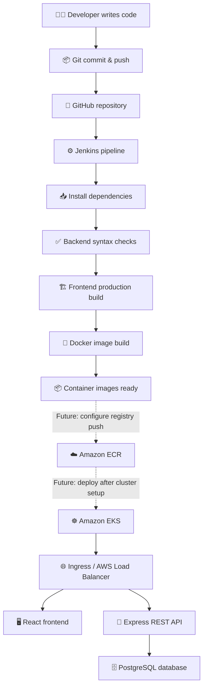
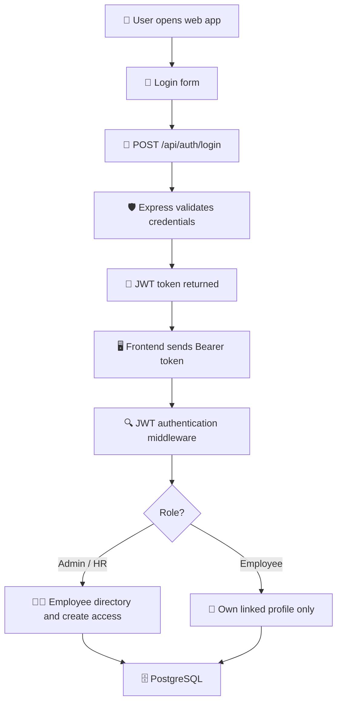
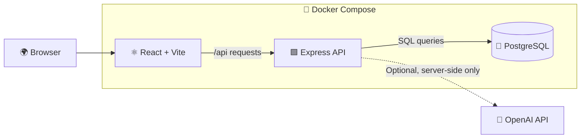

# 👥 Employee Management System (EMS)

<p align="center">
  <strong>A full-stack employee management application built with modern development and DevOps practices.</strong><br/>
  🔐 Secure authentication · 🧑‍💼 Role-based access · 🐳 Dockerized services · 🚀 CI/CD-ready
</p>

<p align="center">
  
  
  
  
  
  
  
  
  
</p>

---

## 📌 Project Overview

The **Employee Management System** is a learning-focused full-stack project for managing employee information through a web interface and REST API. It demonstrates how frontend, backend, database and DevOps tools fit together in an application delivery workflow.

### ✨ Key Features

- 🔑 JWT-based login and authentication.
- 🛡️ Role-based authorization for **Admin**, **HR** and **Employee** users.
- 🧑‍💼 Admin/HR can view, add, edit and delete employee records.
- 👤 Employees can view only the profile linked to their account.
- 🗄️ PostgreSQL database with an initialization migration.
- 🐳 Docker Compose workflow for local development.
- ⚙️ Jenkins pipeline for backend checks, frontend build and container image build.
- ☸️ Kubernetes deployment and service templates.
- ☁️ Terraform templates for AWS VPC and EKS infrastructure.
- 🤖 Optional AI assistant endpoint, protected by backend authentication and role-aware context checks.

## 🧰 Technology Stack

| Layer | Tools | Purpose |
|---|---|---|
| 🎨 Frontend | React, Vite, JavaScript, CSS | User interface and employee dashboard |
| ⚙️ Backend | Node.js, Express.js | REST API and business logic |
| 🔐 Security | JWT, bcrypt, Helmet, CORS, rate limiting | Authentication and API protection |
| 🗄️ Database | PostgreSQL | Employee and user records |
| ✅ Validation | Zod | Validate incoming employee data |
| 📦 Containers | Docker, Docker Compose | Package and run application services |
| 🔄 CI/CD | Jenkins | Automate checks and build stages |
| ☸️ Orchestration | Kubernetes | Deployment and service manifests |
| ☁️ Infrastructure as Code | Terraform, AWS VPC, Amazon EKS | Cloud infrastructure templates |
| 🤖 Configuration Automation | Ansible | Prepare Ubuntu hosts |
| 🧪 Testing | Node.js checks, health-check script | Basic validation and smoke testing |

## 🏗️ Project Structure

```text
employee-management-system/
├── frontend/
│   ├── src/
│   │   ├── components/
│   │   ├── pages/
│   │   ├── routes/
│   │   ├── main.jsx
│   │   └── styles.css
│   ├── Dockerfile
│   ├── nginx.conf
│   ├── index.html
│   ├── vite.config.js
│   └── package.json
├── backend/
│   ├── config/
│   │   └── db.js
│   ├── controllers/
│   │   ├── authController.js
│   │   ├── employeeController.js
│   │   └── chatController.js
│   ├── routes/
│   │   ├── authRoutes.js
│   │   ├── employeeRoutes.js
│   │   └── chatRoutes.js
│   ├── middleware/
│   │   └── auth.js
│   ├── server.js
│   ├── Dockerfile
│   └── package.json
├── database/
│   └── migrations/
│       └── 001_init.sql
├── tests/
│   ├── README.md
│   └── healthcheck.mjs
├── k8s/
│   ├── namespace.yaml
│   ├── frontend.yaml
│   ├── backend.yaml
│   ├── ingress.yaml
│   └── config.yaml
├── terraform/
│   ├── main.tf
│   ├── variables.tf
│   └── outputs.tf
├── ansible/
│   └── playbook.yml
├── Jenkinsfile
├── compose.yaml
├── .gitignore
├── .env.example
└── README.md
```

## 🔄 Application Workflow

### 1. 👩‍💻 Development to deployment



> ℹ️ The current Jenkins pipeline checks backend syntax, builds the frontend and builds Docker images. Registry push and automated EKS deployment are future enhancements, not yet configured.

### 2. 🔐 Login and request flow



### 3. 🧩 Service architecture



## 🚀 Getting Started (Local Setup)

### ✅ Prerequisites

- 🟢 [Node.js](https://nodejs.org/) 24 or compatible runtime
- 🐳 [Docker Desktop](https://www.docker.com/products/docker-desktop/) with Docker Compose
- 🐙 [Git](https://git-scm.com/)
- 🧑‍💻 [Visual Studio Code](https://code.visualstudio.com/) (recommended)

### 1️⃣ Clone the repository

From the repository root, enter the application folder:

```bash
git clone https://github.com/kunald-89/employee-management-system.git
cd employee-management-system/code/employee-management-system
```

### 2️⃣ Configure environment variables

**Windows PowerShell:**

```powershell
Copy-Item .env.example .env
```

**Linux / macOS:**

```bash
cp .env.example .env
```

Open the local .env file and replace the example values. Use a unique JWT secret of at least 32 characters and a strong bootstrap administrator password of at least 14 characters.

> 🔒 Never commit .env to GitHub. The .env.example file contains placeholders only.

### 3️⃣ Start the application

```bash
docker compose up --build
```

Docker Compose starts the PostgreSQL database, backend API and frontend web server.

### 4️⃣ Open the application

| Service | URL |
|---|---|
| 🖥️ EMS Frontend | http://localhost:5173 |
| 🔌 Backend API health | http://localhost:5000/api/health |

Sign in with the bootstrap administrator email and password configured in your local .env file.

### 5️⃣ Stop the application

```bash
docker compose down
```

To also delete the local database volume and its data (⚠️ destructive):

```bash
docker compose down -v
```

## 🔌 API Endpoints

| Method | Endpoint | Access | Description |
|---|---|---|---|
| GET | `/api/health` | Public | API and database health check |
| POST | `/api/auth/login` | Public | Authenticate and receive JWT |
| GET | `/api/auth/me` | Authenticated | Get current account details |
| GET | `/api/employees` | Admin / HR | List employee records |
| POST | `/api/employees` | Admin / HR | Create an employee record |
| PUT | `/api/employees/:id` | Admin / HR | Update an employee record |
| DELETE | `/api/employees/:id` | Admin / HR | Delete an employee record |
| GET | `/api/employees/me` | Authenticated | Get the current user's linked employee profile |
| POST | `/api/chat` | Authenticated | Optional AI assistant endpoint |

Protected endpoints require this HTTP header:

```http
Authorization: Bearer <your-jwt-token>
```

## 👥 Roles and Permissions

| Role | Permissions |
|---|---|
| 👑 Admin | View, add, edit and delete employee records and access own account |
| 🧑‍💼 HR | View, add, edit and delete employee records and access own account |
| 👤 Employee | View only the employee profile linked to their login |

**Note:** Employee create, update and delete actions are available to Admin/HR roles through both the API and dashboard. A secure employee-account linking/provisioning process still needs to be implemented.

## ⚙️ DevOps and Deployment

### 🔄 Jenkins CI pipeline

The root Jenkinsfile currently runs:

1. 📥 Checkout source code.
2. 🧩 Install backend dependencies and run JavaScript syntax checks.
3. 🏗️ Install frontend dependencies and create a production build.
4. 🐳 Build application container images using Docker Compose.

Run Jenkins on an agent with Git, Node.js/npm and Docker/Compose installed.

### ☸️ Kubernetes

The k8s directory contains a namespace, frontend and backend Deployments/Services, ConfigMap and Secret examples, and an Ingress manifest for an AWS Load Balancer Controller setup.

Before deployment, replace example container image names, domain and secret values. Configure PostgreSQL separately; these manifests do not deploy a database.

### ☁️ Terraform (AWS)

The terraform directory contains starter infrastructure code for an AWS VPC, subnets, Amazon EKS cluster and managed worker node group.

Review cost, security, networking, Kubernetes version compatibility and Terraform state configuration before applying. **No AWS infrastructure has been provisioned by this repository.** Running Terraform may create billable resources.

### 🤖 Ansible

The ansible playbook is a basic Ubuntu host preparation example. Define and review an inventory before running it. Ansible is not required for the local Docker Compose workflow.

## 🧪 Basic Checks

Backend syntax and API integration tests (start Docker Compose first; see [tests/README.md](tests/README.md)):

```bash
cd backend
npm install
npm run check
npm run test:api
```

Frontend production build:

```bash
cd frontend
npm install
npm run build
```

API health check after starting services:

```bash
node tests/healthcheck.mjs
```

See [tests/README.md](tests/README.md) for the Windows 11 step-by-step testing guide and current test coverage. The test suite uses a local development database and should never be run against production data.

## 🔐 Security Notes

- Store passwords as bcrypt hashes; never store plaintext passwords.
- Keep JWT signing secrets and API keys in environment variables or a secrets manager.
- Do not expose database ports publicly.
- Use HTTPS/TLS and secure token handling appropriate to your production architecture.
- Add audit logging, password reset, account provisioning, backups and monitoring before handling real employee information.
- Review role checks and employee-to-account linking carefully.
- Do not place OpenAI API keys in frontend code. The optional AI call is made by the backend.
- Do not use real HR or personal data in this learning project without an approved privacy and security review.

## 🛣️ Future Improvements

- [x] ✏️ Add employee update and delete operations.
- [ ] 🧾 Add audit logging for employee record changes.
- [ ] 🔗 Build a secure employee-account invitation and linking workflow.
- [ ] 🔁 Add password reset and token lifecycle management.
- [ ] 🧪 Add unit, integration and end-to-end tests.
- [ ] 🔍 Add dependency scanning, code quality and container vulnerability scanning.
- [ ] 📦 Push versioned images to Amazon ECR from Jenkins.
- [ ] 🚀 Add automated deployment to Amazon EKS.
- [ ] 📈 Add Prometheus, Grafana and centralized logging.
- [ ] 🗄️ Configure managed PostgreSQL, backups and recovery procedures.

## ⚠️ Project Status

This is an educational starter project and **is not production-ready HR software**. The local application source and deployment examples are provided to support learning and experimentation. Complete the security, privacy, testing, account provisioning and operational work before using it with real employees.

## 👨‍💻 Author

**Kunal Dange**

🔗 GitHub: [@kunald-89](https://github.com/kunald-89)

⭐ If this project helps your learning, consider giving the repository a star and sharing suggestions through GitHub Issues.
