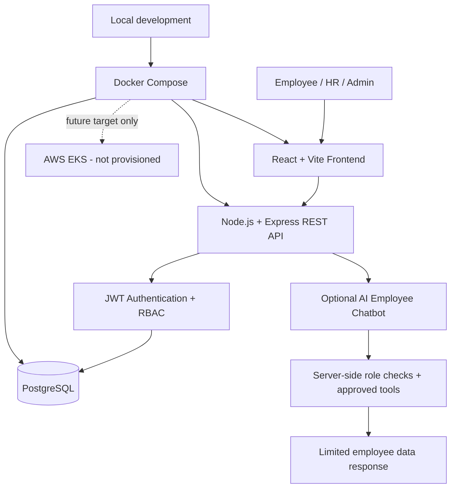

# EMS Architecture and Workflow

## High-level architecture

## Request workflow

1. A user opens the React web app.
2. The frontend sends sign-in details to the Express API.
3. The backend verifies the password hash and issues a short-lived JWT.
4. Protected API routes validate the JWT and check the user's role.
5. Authorized requests read or write permitted data in PostgreSQL.
6. If AI chat is enabled, the server exposes only predefined tools and checks permissions before returning employee information.

## Access model

- **Employee:** own linked profile only.
- **HR/Admin:** authorized employee directory access.
- **Chatbot:** cannot run arbitrary SQL or edit records; tool access is enforced by the server.

## Deployment status

Docker Compose is the local development path. AWS EKS is a future target only; this repository does not provision cloud resources. Review cost and security before any deployment.
